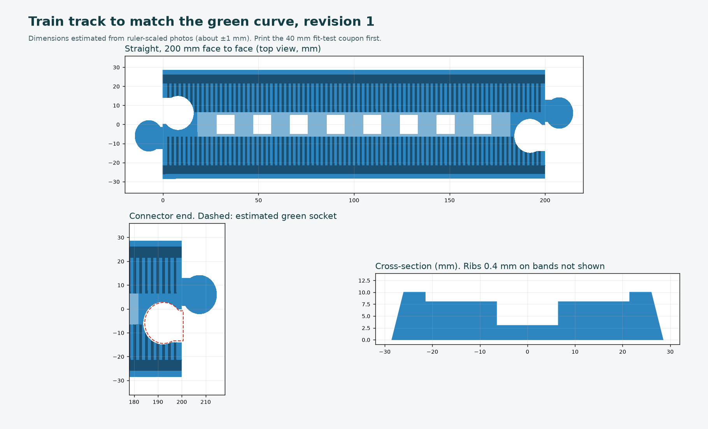

# Train track

A straight toy-train track designed to connect to a lime-green curved piece
from a commercial plastic toy-train system (2026 production). It replaces a
downloaded third-party straight that did not fit. That model's knobs are about
7 mm across, against about 17 mm on the green piece, and its body is about 13 mm
narrower.



**Revision 1. The dimensions are estimates, not measurements of the green piece.**
They come from two phone photos, scaled using a ruler in the frame. Expect errors
of about ±1 mm. Print the fit-test coupon before the full straight.

## Print files

Download the [revision 1 print pack](train-track-v1-print-pack.zip) or use these
files directly:

| File | Part |
|---|---|
| `print-files/optional/fit_test_coupon.3mf` | 40 mm piece with both connector ends. Print this first (about 17 cm³). |
| `print-files/01_straight_200mm.3mf` | Straight, 200 mm from end face to end face (229 mm including knobs, about 79 cm³). |

Print flat, bottom down, in millimeters. The model has no overhangs, so it
needs no supports. If your printer has elephant's foot,
correct it in the slicer, because a flared first layer tightens the knob fit.

## Fitting the coupon

1. Drop the coupon's knob into the green piece's socket from above, then the
   green knob into the coupon's socket. Both should drop in with light play and
   should not pull apart sideways.
2. Check the step at the joint. The running bands are 8 mm high and the rims 10 mm.
3. If something is off, measure the green piece with calipers. Edit the
   constants at the top of `build_track.py` and rebuild:
   - The knob won't go in: reduce `KNOB_SEMI_Y`/`KNOB_SEMI_X`, or narrow `KNOB_NECK`.
   - The green knob won't go in: increase `SOCKET_SEMI_Y`, or widen `SOCKET_MOUTH`.
   - The connectors don't line up: adjust `CONNECTOR_OFFSET`.
   - The joint has a step: adjust `BAND_TOP`, `RIM_TOP` or `DECK`.

## How the green piece was measured

- **Scale:** The top-down photo was scaled using the ruler's centimeter labels
  (6.13 px/mm).
- **Shape:** The arc was fitted through the eight slot centers, which gives a
  centerline radius of about 189 mm. The arc is about 60°.
- **Layout:** The piece was unrolled into straight track coordinates to read its
  cross-track layout and both ends.
- **Connectors:** Each end has one knob and one socket, centered about 6 mm
  either side of the centerline. Looking outward from an end, the knob is on
  the left. Both ends agree.
  - Socket: 17.2–18.3 mm across inside, with a 12.4–13.8 mm mouth and about
    16 mm deep. It has a lip of about 3.5 mm on the centerline side of the
    mouth and about 1 mm on the outer side.
  - Knob: it photographs larger than the socket, so its outline is
    unreliable. The design follows the socket instead.
- **Magnification correction:** The top of the piece sits about 10 mm above the
  ruler, so the photo enlarges it slightly. Top-surface sizes were reduced by
  about 3%.
- **Height:** The side photo was compared against the printed white track,
  whose walls are 9.5 mm. That gives running bands of about 8 mm and end blocks
  or rims of 10–12 mm.
- **Width:** About 51 mm across the top and 57 mm at the base.
- **Fit by design:** The printed knob is smaller than the estimated green socket
  and the printed socket is larger than the green knob. The fit errs toward
  loose.

An overlay of this model's outline on the unrolled photo matched the green
socket and fell inside the green knob at both ends.

## Dimensions

| Feature | Value |
|---|---|
| Footprint | 57 mm wide at the base, 52 mm at the top |
| Running bands | 8 mm high, from 6.5 to 21.5 mm off center, with 0.4 mm ribs |
| Rims | 10 mm high, 43 mm clear width |
| Center channel | 13 mm wide, 3 mm floor, 10 × 9.5 mm slots at a 19.2 mm pitch |
| Knob | 16.2 mm wide head, 11.6 mm neck, reaches 14.6 mm, 7 mm high |
| Socket | 18.0 mm wide, 13.8 mm mouth, 16.2 mm deep, through the full height |

`verification.json` records the digital checks:

- Every part is a single watertight solid.
- Printed knob in printed socket: at least 0.6 mm of clearance.
- Estimated green knob in printed socket, and printed knob in estimated green
  socket: about 0.5 mm and 0.35 mm of clearance.
- A seated joint has zero overlap.
- Pulling a seated joint 3 mm apart collides with the socket lip, so joints
  hold together.

Physical fit, slicing and the fit to the real green piece are untested.

## Rebuild

From this directory:

```sh
../.venv/bin/python build_track.py
```

This rewrites `print-files/`, `verification.json`, `track-preview.png` and both
print packs.
